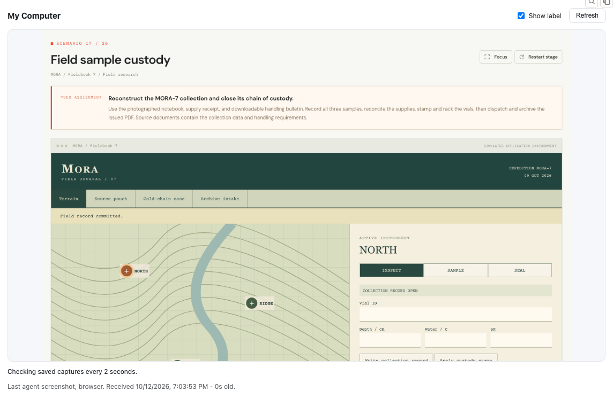
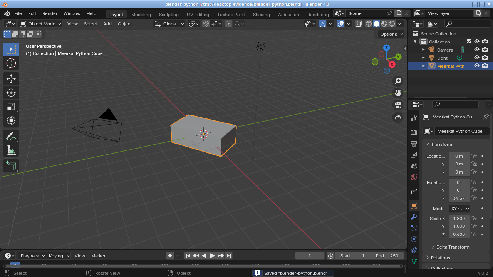

# Meerkat Computer

Give each Meerkat agent its own computer: a browser, Linux desktop, terminal and
files that stay with it between sessions. Run the computers on your own server or
in your GCP project.



*Workflow Bench running in the browser, viewed through the inline Console
preview. See the latest computer-use screenshot, with a capture time and optional
label. [Full Console view](docs/assets/screenshots/console-context.png) ·
[Connect it to your Console](docs/integrations/console.mdx).*

## Run your first task

This example runs a Meerkat agent that browses a website and reports what it finds.
It handles the computer attachment, tools and cleanup for you.

**Once per host:** set up a [Linux server](docs/deployment/local-linux.mdx) or
[GCP host](docs/deployment/gcp.mdx) with the `browser` profile. On your client,
you need Python 3.11+, [uv](https://docs.astral.sh/uv/) and a compatible
[Meerkat 0.9.0](https://github.com/lukacf/meerkat/releases/tag/v0.9.0)
`rkat-rpc` on your PATH. The broker and example target Core/SDK 0.9.0.
The optional inline preview targets [Meta 0.9.0](https://github.com/lukacf/meerkat-meta/releases/tag/v0.9.0).
See [compatibility](docs/reference/compatibility.mdx) for tested scope and limitations.

### 1. Get the client

```bash
git clone https://github.com/lukacf/meerkat-computer.git
cd meerkat-computer
uv sync --locked
```

### 2. Choose the agent's identity

```bash
mkdir -p .state/first-agent
cp examples/owner.json .state/first-agent/owner.json
```

Edit that file to identify your agent. The included example is:

```json
{
  "kind": "identity",
  "realm": "home",
  "namespace": "mob:household",
  "identity": "researcher"
}
```

Your application chooses these values. Keep them the same between runs and the
agent gets the same computer back.

<details>
<summary><strong>Connect to your host and load credentials</strong></summary>

The example expects the broker at `http://127.0.0.1:18760`. For a remote Linux
host, leave this tunnel running in another terminal:

```bash
ssh -N -L 18760:127.0.0.1:18760 your-linux-host
```

GCP users can use the [IAP tunnel helper](docs/deployment/gcp.mdx) instead.
Load `MEERKAT_COMPUTER_OPERATOR_TOKEN` from your host's private operator
environment and `OPENAI_API_KEY` from your normal secret store. These stay on the
trusted client; the agent receives its own limited computer grant.

This standalone example uses a direct broker connection. The optional
[wake-on-demand gateway](docs/operations/host-lifecycle.mdx) has a separate host
integration path.

</details>

### 3. Give it a task

Replace `YOUR_OPENAI_MODEL` with a model available to your account, then run:

```bash
uv run --locked --with meerkat-sdk==0.9.0 python examples/run_agent.py \
  --owner-file .state/first-agent/owner.json \
  --runtime-generation 1 \
  --provider openai --model YOUR_OPENAI_MODEL \
  "Open https://example.com, follow its link, and summarize the destination page. Take a final observation."
```

You get the agent's answer, computer ID, token usage and tool-call count in your
terminal. Run it again with a different task to reuse the same computer. For
Anthropic, load `ANTHROPIC_API_KEY` and use `--provider anthropic --model YOUR_ANTHROPIC_MODEL`.

The example creates a fresh runtime, so generation `1` is appropriate here.
Applications embedding the client supply their actual execution generation.
It releases control when the task ends; the computer and files remain available.

**Want the preview above?** This command is a terminal example. An Apps-capable
Console displays the inline preview through the [Console setup](docs/integrations/console.mdx).
For manual attachment or embedding in your own application, use the
[full walkthrough](docs/quickstart.mdx) or [host client guide](docs/integrations/host.mdx).

## Give it more than a browser

With a desktop profile configured, add `--profile desktop --slot desktop` to the
command above. The agent can use UI controls through OS accessibility, work
through an app's scripting API, and inspect screenshots to check the result.



*Blender in the Linux desktop qualification run: Python changed the cube's shape
and rotation, saved the scene, and a screenshot verified the visible result.
[How agents use Blender](docs/guides/blender.mdx).*

| Ask your agent to... | What it uses |
| --- | --- |
| Browse a site, fill a form, or compare pages | [Chromium, page structure and screenshots](docs/guides/browser.mdx) |
| Create a Blender scene or work in a native app | [Python, desktop accessibility and screenshots](docs/guides/native-desktop.mdx) |
| Read a PDF and check its page layout | [Evince and Poppler utilities](docs/guides/pdf.mdx) |
| Write code, run tests and save an artifact | [Guest shell and files](docs/guides/workspace.mdx) |
| Sign in with an assigned account | [Reusable credentials and secure input](docs/guides/credentials.mdx) |

Shell access, installed apps and guest administrator privileges come from the
selected profile. The supplied desktop image can include Blender, GIMP, Inkscape,
LibreOffice and Mousepad. Both desktop bundles include Evince for PDF viewing
and Poppler utilities for text extraction, metadata and page rendering.

## A computer that stays with the agent

- **Persistent by identity.** New sessions or models can return to the same
  files, browser profile and installed apps. Session-owned computers are also
  supported.
- **Your infrastructure.** Use Incus containers or VMs on a home server or GCP.
  The optional gateway wakes a GCP host on demand and suspends it after idle time.
- **Separate control.** Each execution receives an expiring grant to its assigned
  computer. Host credentials and other agents' computers stay outside that grant.
- **Full-state VM forks.** Explicitly clone disk and RAM when supported by the
  host, then give the child its own grant. See [forks](docs/guides/forks.mdx).

Meerkat owns the agent, model and session. Meerkat Computer supplies the assigned
computer and its MCP tools. Your application decides which agents receive them.

## Learn more

Start with [the documentation](docs/introduction.mdx), then follow the guide for
your next step:

| I want to... | Read |
| --- | --- |
| Connect an existing agent or product | [Host integration](docs/integrations/host.mdx) |
| Display computer use in Console | [Inline previews](docs/integrations/console.mdx) |
| Control idle costs and resume sleeping hosts | [Host lifecycle](docs/operations/host-lifecycle.mdx) |
| Share input files and collect results | [Upload and download](docs/guides/file-transfers.mdx) |
| Understand security and deferred action review | [Security](docs/operations/security.mdx), [future exploration](docs/development/future-action-review.mdx) |
| Operate a pool or diagnose a failed request | [Operations](docs/operations/lifecycle.mdx), [troubleshooting](docs/operations/troubleshooting.mdx) |
| Inspect exact flags, tools or configuration | [CLI](docs/reference/cli.mdx), [tools](docs/reference/tools.mdx), [configuration](docs/reference/configuration.mdx) |

**Status:** 0.1.0 release candidate, distributed from source. Linux guests are supported; the
Console preview requires native MCP Apps support and consumer adoption.
See [compatibility](docs/reference/compatibility.mdx),
[changelog](CHANGELOG.md) and [verification](VERIFICATION.md) for tested scope
and known limits. [Screenshot provenance](docs/assets/screenshots/README.md).

## Contributing

The repository separates the Rust broker/operator (`src/`), Python worker and MCP
adapter (`python/`), inline App (`ui/`), host tooling (`infra/`) and documentation
(`docs/`). Configuration and runnable examples live in `configs/` and `examples/`.

```bash
make test
make lint
make docs-check
```

[CONTRIBUTING.md](CONTRIBUTING.md) covers development and local docs preview.
[RELEASING.md](RELEASING.md) covers artifact installation and release checks.
Report security concerns through [SECURITY.md](SECURITY.md).
Licensed under [MIT](LICENSE).
