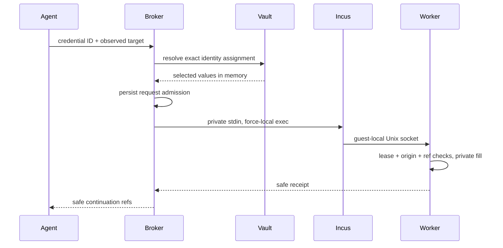

Meerkat Computer owns this optional feature. It requires no Meerkat or MobKit
source changes and does not use provider `auth_binding` as a website vault.

Save a login once, then assign its reference to one or more durable identities.
Assignments use the exact `(realm, namespace, identity)` from the trusted host's
computer attachment. Sessions, models, display names and runtime generations are
not identity keys. Membership in a realm grants no credential access. The broker
stores references, not another agent roster.

## Enable

Credentials are disabled when the optional `[credentials]` table is absent.
Create a key as the account that runs the broker, outside its state directory:

```bash
./scripts/repo-cargo run -- init-vault-key \
  --key-file "$HOME/.config/meerkat-computer/credential.key"
```

Set an absolute key path in your broker configuration:

```toml
[credentials]
key_file = "/absolute/private/config/meerkat-computer/credential.key"
```

The key is a private 32-byte file. Initialization refuses to overwrite an existing
key. Keep it outside `server.state_dir`, store its backup separately from the
vault, and run the broker under the same Unix account. Existing directories must
be owned by that account and not writable by other users; files must be regular,
owned files with mode 0600. New directories use mode 0700.
The vault is `server.state_dir/vault`, an AES-256-GCM authenticated encrypted
snapshot with fresh random nonces and atomic replacement. Its labels, origins,
usernames and assignment edges are encrypted too. Missing or wrong keys and
corrupted ciphertext fail closed; there is no plaintext fallback.

This is encryption of the persisted vault, not protection from the broker's host
administrator. A key stored on the same physical disk does not protect against
an attacker who obtains both that key and the vault. Key rotation, external key
management and an OS keychain backend are future work.

Rebuild the guest image from this revision before enabling delivery. The new
worker serves a private Unix socket in addition to its ordinary worker API.
Profiles need `browser` and `browser_semantics` so a secret can be bound to
observed fields. Visual-only profiles do not expose credential tools.

## Operator workflow

Start the broker normally and open `http://127.0.0.1:18760/credentials`. For a
remote Linux or GCP host, forward the broker port over SSH or GCP IAP, then open
the forwarded loopback address. Keep the broker bound to loopback. Do not expose
its HTTP listener directly to a network.

Enter the broker operator token in the separate masked field. It lives only in
that tab's memory and is cleared on Lock or page close. It is not placed in URL
parameters, cookies or browser storage. This token has full broker operator
authority; this page is for the host's operator, not a guest agent.

The page supports:

- Add or replace a credential without reading its saved secret back.
- Select several credentials and assign or revoke them for several identities
  in one transaction. Cross-realm batches are rejected atomically.
- Choose known agents from existing computer ownership records, with duplicate
  identities collapsed across their slots. Explicit identity entry remains
  available for agents that have not attached a computer yet. This picker reads
  the existing broker API and does not create a separate agent directory.
- Filter by realm, namespace and identity to see an agent's assignments.
- Respond to a pending login request with a password or manually supplied OTP.
- Use input once, or explicitly save it and assign it to the requesting identity.

Choosing Save persists and assigns the credential before attempting input in the
guest. A stale page or failed delivery can therefore leave the saved credential
available in the library. Refresh the library to inspect that outcome.

Input fields clear before submission, including on failure. Failed or uncertain
submissions are not retried automatically. A request link contains only an opaque
request ID; it still requires operator authentication. The site and requesting
identity are shown before input. The current lease and observed target are
checked again when the operator responds.

## Agent tools

The existing stdio MCP adapter discovers the tools automatically:

| Tool | Purpose |
| --- | --- |
| `credentials_list` | Return assigned login IDs, labels, exact origins and versions. |
| `credentials_use` | Fill an assigned login into observed browser fields. |
| `credentials_request` | Create an expiring one-time input request and return the operator link. |
| `credentials_status` | Poll the request and obtain its safe delivery receipt. |

No tool accepts secret values or caller-selected identity references. A use call
contains an opaque credential ID and an observed target:

```json
{
  "credential_id": "credential-id-from-list",
  "target": {
    "origin": "https://example.com",
    "observation_id": "current-browser-observation",
    "username_ref": "observed-username-field",
    "secret_ref": "observed-password-field"
  }
}
```

Omit `username_ref` for a password-only form. A saved username is not delivered
in that case. A manually supplied OTP uses `secret_ref` with no username field.
Origin matching is exact, including scheme, host and nondefault port. Subdomains,
wildcards, userinfo and URL paths do not grant access. Literal-loopback HTTP
origins are supported for local applications and fixtures; other sites require
HTTPS. The worker also checks the actual top-level document, field frame and
form destinations. Callers cannot substitute CSS selectors for observed refs.
Known GET forms and GET submit overrides are rejected so login values are not
put into navigation URLs.

Delivery fills fields; it does not submit the login. Its receipt includes a new
observation ID and only previously observed noneditable action refs. The agent
can click the already observed submit control with that ID. Screenshots, browser
semantics and native desktop observations are withheld while the affected
document may expose input. A full new document or closing the affected tab
releases the guard; changing a URL fragment does not. The guard survives worker
restart. Blind keyboard/coordinate actions are denied while it is active.

A session-owned computer can request operator-approved one-time input bound to
that exact lease. It cannot list or use identity-assigned credentials, or save an
implicit identity assignment.

## Delivery and lifecycle



The broker runs beside Incus and uses `--force-local`. The private payload stays
on host/guest control pipes and the guest's mode 0600 Unix socket; it is not sent
to the worker's network HTTP API. Incus exec arguments contain only static helper
code and the fixed socket path. The guest never receives the vault, its key or a
credential-store reader token. Remote operator traffic is encrypted by the SSH
or IAP tunnel.

A generated Meerkat machine owns pending, in-flight and terminal request states.
Each request is bounded by the control lease and a maximum ten-minute response
window. Admission precedes saving input or touching the guest. Takeover, release
and expiry prevent pending delivery. Restart cancels pending requests and marks
in-flight requests unknown. Unknown delivery never authorizes an automatic
retry. Receipts and journals store opaque IDs and public target metadata, never
passwords or password hashes. Assignment mutations serialize with delivery, so a
completed revocation prevents subsequent use.

## Scope and limits

Each identity keeps its own browser profile and website sessions. Updating a
saved credential changes future deliveries for all assigned agents. Revoking an
assignment prevents future deliveries; it does not revoke a website cookie that
was already issued. Sign out or revoke/rotate access at the website when needed.
"Use once" means the vault does not save input, not that the website cannot keep
the browser signed in.

The authorized website and that guest's administrator receive the selected input.
An agent with guest root can extract its own delivered input or cookies. This
feature protects the other vault entries and the normal model/chat/receipt path;
it cannot make a malicious website or an administrator-controlled guest unable
to disclose a value they already received. The privacy guard covers the input
document, not arbitrary subsequent server content or agent-written programs.

V1 does not import whole browser profiles, handle passkeys, automate external MFA
approval, mint website OAuth tokens, or provide a remote password-reveal API.
Bundled assignment sets and external vault backends can be added without changing
Meerkat. Embedding hosts can supply an implementation of `CredentialStore` through
`Broker::open_with_credential_store`; this build supplies only the encrypted local
implementation. The public vault/service boundary is separate from browser effects.

## Tests

```bash
make test
make lint
make smoke        # Real Chromium worker and operator UI tests.
make smoke-stack  # Real broker, guest process, private socket and stdio MCP.
```

Default tests use only synthetic values and fake infrastructure. Browser and
stack tests run local fixtures and never log in to external accounts. They prove
the credential flow and process boundaries, not Incus/GCP isolation. See
[historical verification record](https://github.com/lukacf/meerkat-computer/blob/main/VERIFICATION.md) for the recorded TDD and qualification results.
