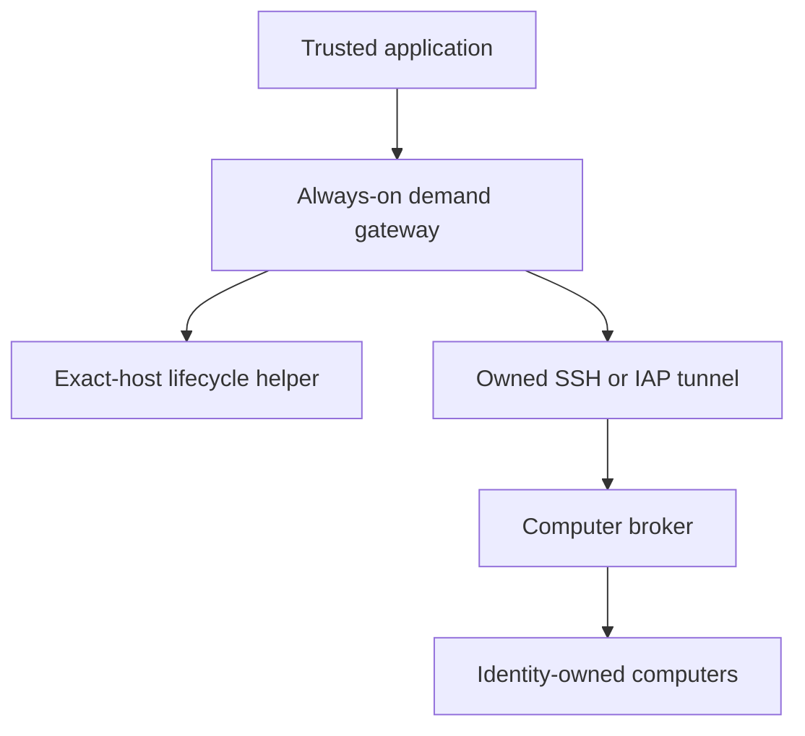

Run the demand gateway on an always-on machine, outside the computer host that
it suspends. Applications connect to this gateway through loopback HTTP. It
wakes the configured host, establishes its private broker connection, and
forwards the original request once. The broker still owns computer assignments,
grants and guest actions; the gateway owns the outer host's power policy.



The [inline computer preview](/integrations/console) continues to use the regular
computer observations. This setup adds no Console sidebar or separate desktop
streaming service.

## Configure the gateway

Adapt `examples/gateway.toml` from the source repository. Supply absolute local
paths, the exact saved creation-intent file, and your own cloud account, project,
zone and host name. The example uses a five-minute idle period:

```toml
listen = "127.0.0.1:18761"
broker_url = "http://127.0.0.1:18760"
state_dir = "/var/lib/meerkat-computer-gateway"
host_token_env = "MEERKAT_COMPUTER_HOST_TOKEN"
idle_suspend_seconds = 300
request_timeout_seconds = 300
wake_timeout_seconds = 420
```

`listen` and `broker_url` must be loopback addresses. The gateway's listen port
and its forwarded broker port must differ. Keep one gateway and one lifecycle
writer for each physical or cloud host, with a persistent private `state_dir`.
Another gateway cannot open the same locked state directory; do not bypass that
ownership by creating another state directory for the same host.

| Configuration | Contract |
| --- | --- |
| `idle_suspend_seconds` | Required; `0` disables automatic suspension, otherwise up to 604800 seconds. The example selects `300`. |
| `request_timeout_seconds` | Broker HTTP deadline; default `300`, range 1-3600 seconds. |
| `wake_timeout_seconds` | One deadline shared by the host command, tunnel startup and readiness; default `420`, range 1-1800 seconds. Allow for wake, forwarding and queued work in the application's HTTP timeout. |
| `wake_command` | Required argv array. Exit successfully only after reconciling the configured host's power state. |
| `suspend_command` | Required argv array. Confirm suspension; never substitute stop or restart. |
| `tunnel_command` | Optional argv array for a foreground tunnel owned by this gateway process. Omit only when another explicitly managed transport supplies the broker endpoint. |

Commands receive no model-supplied arguments. They run directly as argv, without
shell interpolation, and their output is not returned to agents. The supervisor
must provide their dependencies and cloud credentials. Configure the correct
broker service to start at boot before using a power-only wake command. A cold
host reaching `RUNNING` does not by itself make the broker ready.

The gateway waits for the broker's `/health` receipt after the wake command and
tunnel startup. The tunnel runs in the foreground; the gateway terminates its
owned process group when replacing it or after a confirmed suspension. Do not
configure an already-running shared tunnel as if it were owned by this process.

On Unix, SIGTERM and Ctrl-C drain the HTTP server and release the owned tunnel.
Allow the supervisor enough time for active requests to finish. A forced kill
can leave a descendant tunnel behind; a new gateway refuses an already-occupied
upstream port. Reconcile its saved state and remove only the verified owned
process group before restarting. Do not adopt or kill an unrelated listener.

Start the installed binary under your service supervisor:

```bash
rkat-computer gateway --config /etc/meerkat-computer/gateway.toml
```

## Keep host and guest credentials separate

Supply a separate random host token through the configured environment variable,
using the supervisor's protected credential mechanism. A 64-character random
hex token works with both the gateway and Python client. Keep token values out
of the TOML file, command arguments, logs, model inputs and tool results.

Each gateway request carries `X-Meerkat-Computer-Host-Token`. Broker requests also
carry their usual `Authorization: Bearer ...`: the operator token for attachment
and inventory, or the exclusive control token for guest operations. The gateway
checks its own credential and strips it before forwarding; it preserves the
broker's bearer token. Both the gateway and Python client disable proxy discovery
and automatic redirects.

The host token authorizes host wake and suspension-policy controls. It is a
trusted application credential, not an agent credential or a replacement for a
computer grant. A grant continues to identify one computer, execution and epoch.

## Connect through the Python SDK

Use the gateway URL as `broker_url` and add `host_token` from trusted host
configuration. Omitting `host_token` preserves direct broker behavior.

```python
import os

from meerkat_computer.client import ComputerClient

with ComputerClient(
    "http://127.0.0.1:18761",
    operator_token=os.environ["MEERKAT_COMPUTER_OPERATOR_TOKEN"],
    host_token=os.environ["MEERKAT_COMPUTER_HOST_TOKEN"],
    timeout=900,
) as computer:
    computer.ensure_host()
    inventory = computer.list_computers()
    # The trusted host inspects owner, slot and lease before its next decision.
```

`ensure_host()` explicitly requests readiness without attaching or invoking a
guest action. It is a no-op for a direct broker connection. `list_computers()`
performs one operator-authorized GET and returns immutable, token-free
`ComputerView` values with `computer_id`, `owner`, `slot`, `profile`, `phase`,
`epoch` and an optional `ComputerLease`. A lease snapshot grants no control.

Neither call retries an uncertain attachment. An application can use them to
inspect an assignment after a failed attachment, then make an explicit recovery
decision using the current session and runtime generation. Reuse the normal
[host integration](/integrations/host) for attachment, renewal and MCP setup.

The native MCP adapter accepts the same additional credential from an explicitly
named environment variable:

```bash
meerkat-computer-mcp --broker-url http://127.0.0.1:18761 \
  --binding-file /run/meerkat/computer-binding.json \
  --host-token-env MEERKAT_COMPUTER_HOST_TOKEN --timeout 900 --mcp-apps
```

Gateway mode performs one explicit wake during connection setup before MCP
initialization. The product host's MCP startup deadline must allow this wake too;
when that deadline is short, run `ensure_host()` in trusted setup before starting
the adapter. Subsequent tool discovery and preview requests remain passive.
Direct connections retain their 150-second default HTTP timeout; gateway
connections default to 900 seconds. No credential is added to tool arguments.

## Demand, passive reads and idle suspension

Attachments, explicit wake and ordinary guest tool calls count as demand. They
can wake a sleeping host and update its last activity time. Computer observation
is demand too. Concurrent requests share a serialized wake; a forwarded request
holds the host awake until its response is collected.

Inventory, tool listings, health and preview GETs are passive. Lease renewal,
release, broker reaping and the `credentials_status` / `credentials_list` tool
calls are passive too. These requests neither wake a sleeping host nor extend
the idle deadline. A passive request to a sleeping host returns `host_asleep`
with `effect: "none"`. A passive request being forwarded still prevents suspension
while its response is in flight. Merely keeping a lease or polling a preview does not
keep the outer host running.

The gateway checks idle eligibility every ten seconds. It suspends only after
the configured idle period, with no active requests and no suspension inhibit.
This is separate from the broker's per-computer `idle_stop_seconds`, whose
[zero-value meaning differs](/operations/lifecycle#renewal-and-shutdown).

<Warning>
Suspending the outer host pauses every guest on it. Requests sent directly to
the broker, other services on the host, and background work continuing after an
HTTP response are not tracked by this gateway. For a shared host, coordinate all
work through one lifecycle owner, disable automatic suspension, or explicitly
inhibit suspension before starting background work.
</Warning>

## Uncertain effects and restart recovery

The gateway never retries a forwarded operation. A failure before forwarding
reports no guest effect; a lost or uncertain response after forwarding remains
unknown. Unknown guest tool errors include the submitted action ID. A host becoming reachable
again does not prove that an earlier attachment or guest action failed.

An uncertain forwarded effect, failed wake or failed suspension persistently
inhibits automatic suspension. Gateway recovery also inhibits suspension if its
saved state records unfinished requests or suspension. A restart preserves this
fence, resets transport readiness, and reconciles the host on the next demand.
It neither resumes an old HTTP request nor manufactures a new guest grant.

These endpoints require the host token and accept no query parameters:

| Endpoint | Purpose |
| --- | --- |
| `GET /host/status` | Inspect the saved gateway phase, active request count, last activity time and inhibit flag without waking. |
| `POST /host/wake` | Request broker readiness; success is `{"ready": true}`. |
| `POST /host/inhibit` | Persistently disable automatic suspension, including while requests are active. |
| `POST /host/clear-inhibit` | After reconciliation, submit `{"confirmed_no_inflight_effects": true}`. Refused while requests or host transitions remain active. |

Clearing the inhibit is a trusted operator assertion that outstanding effects
and background work have been reconciled. The endpoint cannot prove that
assertion. Do not clear it merely because a timeout elapsed or a health check
passed. Keep any application-level unknown-attachment or unknown-action fence
until that application resolves it from authoritative evidence.

A cold broker restart retains computer assignments but invalidates old grants.
Rebuild per-execution attachments and MCP registration on application resume.
A successful host suspend/resume retains processes, but grant expiry still uses
wall-clock time; revalidate access after waking.

## Use the exact-instance GCP helper

The helper consumes the saved state from [GCP creation](/deployment/gcp). It
requires the original immutable VM ID and ownership marker, with explicit
project, account and zone. It never sources a profile, logs in, or changes the
active gcloud configuration.

```bash
uv run --locked python infra/gcp-host.py ensure-running \
  --state /var/lib/meerkat-computer-host/gcp-host.json \
  --wait-seconds 300 --poll-seconds 2 --apply
uv run --locked python infra/gcp-host.py suspend \
  --state /var/lib/meerkat-computer-host/gcp-host.json \
  --wait-seconds 300 --poll-seconds 2 --apply
```

Without `--apply`, these actions only print a local plan. `ensure-running`
starts a `TERMINATED` VM, resumes a `SUSPENDED` VM, or confirms a `RUNNING` VM.
`suspend` suspends a `RUNNING` VM or confirms it is already `SUSPENDED`.
Transitional states are observed within the deadline, with ownership checked on
every observation. Replacement IDs are refused.

Before any power request, the helper writes `resources.instance.pending_power`
to its creation-intent file. If the CLI fails, times out or is interrupted,
another invocation only reconciles that saved request against observed state;
it does not repeat it. Resolve a pending power request before clearing the
gateway inhibit. A failed resume never falls back to stop/start. Existing
`start` and `stop` actions remain explicit operator operations.

## Preserve RAM without a competing stop timer

GCP's `maxRunDuration` with `instanceTerminationAction: STOP` discards memory.
It is not an autosuspend policy. Before adopting gateway-managed suspension,
record the exact host's scheduling settings and explicitly remove that stop
limit while the VM is already terminated:

```bash
gcloud compute instances set-scheduling mc-computer-host \
  --project=example-project \
  --account=operator@example.invalid \
  --zone=us-central1-a \
  --clear-max-run-duration \
  --clear-instance-termination-action
```

These are placeholders, not an executable selection of your host. Verify the
saved ID and owner before applying them. If a separate `terminationTime` is
configured, explicitly clear that deadline too. Retain the previous values for
rollback; do not stop a running VM just to make this policy change. GCP's
[scheduling API](https://docs.cloud.google.com/sdk/gcloud/reference/compute/instances/set-scheduling)
supports STOP or DELETE termination actions, not SUSPEND.

Suspension preserves memory only within GCP's supported lifecycle. GCP
automatically terminates a VM after 60 days suspended, and storage charges remain.
Suspension requires a supported guest OS and enough persistent-disk quota for
memory; GPU/TPU VMs and VMs with more than 208 GB of memory are excluded. Host
failures, maintenance termination, explicit stop and deletion remain distinct
loss-of-RAM paths. See the current
[suspension limits](https://docs.cloud.google.com/compute/docs/instances/suspend-resume-instance#limitations).
Validate a real suspend/resume cycle with the intended nested guests before
claiming end-to-end RAM continuity.
